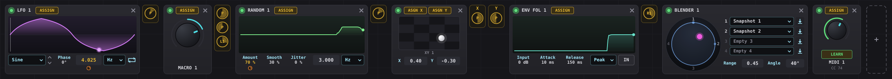

# BigMod

BigMod is a modulation rack that snaps onto any VST3 (or Audio Unit on Mac) plug-in and moves its knobs for you:
macros, LFOs with a curve editor, XY pads, a preset blender, envelope followers, randomizers, MIDI macros, and
cross-modulation between all of them. It follows the MegaMod v1.0 manual feature for feature.



It comes as two plug-ins, exactly like the manual's two modes:

| Plug-in | Use it on | Loads |
|---|---|---|
| **BigMod** (Effect) | a mixer insert | effects: EQs, compressors, distortion, delays... |
| **BigMod Instrument** | a channel-rack / instrument track | synths and samplers |

Formats: **VST3** (Windows, macOS, Linux), **AU** (macOS), plus a **Standalone** app.
It works in FL Studio, Ableton Live, Cubase, Reaper, Bitwig, Studio One, Logic (AU) and any other VST3/AU host.

---

## 1. Get the plug-in files

You need to compile BigMod once for your computer. The easiest way needs no programming tools at all:

### Option A - let GitHub build it (recommended, free)
1. Create a free account at github.com and make a new **repository** (e.g. `bigmod`).
2. Upload everything in this folder to it (drag the files into the "uploading an existing file" page, including the hidden `.github` folder - or use GitHub Desktop).
3. Open the repository's **Actions** tab. A "Build BigMod" run starts automatically (about 10-15 minutes).
4. When it shows a green tick, open the run and download **BigMod-Windows** or **BigMod-macOS** from the *Artifacts* section at the bottom.

### Option B - build it on your own computer
* **Windows:** install *Visual Studio 2022 Community* (tick "Desktop development with C++") and *CMake*. Then in a terminal in this folder:
  ```
  cmake -B build -G "Visual Studio 17 2022" -A x64
  cmake --build build --config Release
  ```
* **macOS:** install Xcode and CMake, then:
  ```
  cmake -B build -G Xcode
  cmake --build build --config Release
  ```
The plug-ins appear in `build/BigModFx_artefacts/Release/VST3/` and `build/BigModInst_artefacts/Release/VST3/`.
(CMake downloads the JUCE framework automatically the first time.)

## 2. Install

Copy **`BigMod.vst3`** and **`BigMod Instrument.vst3`** into the VST3 folder:

* Windows: `C:\Program Files\Common Files\VST3\`
* macOS: `/Library/Audio/Plug-Ins/VST3/` (and the `.component` files into `/Library/Audio/Plug-Ins/Components/` for Logic)

**macOS note:** the downloaded build isn't notarised by Apple. If macOS blocks it, run this in Terminal once:
`sudo xattr -dr com.apple.quarantine "/Library/Audio/Plug-Ins/VST3/BigMod.vst3" "/Library/Audio/Plug-Ins/VST3/BigMod Instrument.vst3"`

### In FL Studio
1. *Options > Manage plugins > Find more plugins* (make sure the VST3 folder above is in the search paths).
2. Effect: open the **Mixer**, click an empty slot on a track and choose **BigMod**.
   Instrument: in the **Channel rack** click **+** and choose **BigMod Instrument**.
3. MIDI into the effect version (for MIDI Macros / one-shot LFO retrigger): route a MIDI Out channel to it, or put it in Patcher.

---

## 3. Quick start (same flow as the manual)

1. Open BigMod and click the **gear** icon -> **Plugins** tab -> **SCAN PLUGINS** -> *Scan for new or updated VST3 plug-ins* -> pick your plug-in folders -> **Scan**. The list is saved and shared by every BigMod in every DAW.
2. Click **+ LOAD PLUGIN** and pick a plug-in. BigMod resizes itself to the plug-in and stays snapped underneath it.
   (The effect version only lists effects, the instrument version only instruments.)
3. Click the dashed **+** box in the rack and pick a modulator, e.g. **LFO**.
4. Click the module's **ASSIGN** button (it flashes), then move any knob in the plug-in's window. A small yellow **P** dial appears next to the module.
   - Can't use the plug-in's window? **Right-click ASSIGN** to pick a parameter from a list.
5. Drag the dial up/down to set how much the LFO moves that knob. Negative values invert the movement. Hover to see the target and amount.

> **Not moving?** Some DAWs pause plug-ins when no audio plays (Pro Tools "Dynamic Plugin Processing", Cubase "Suspend VST3 plug-in processing when no audio signals are received"). Press play or turn that option off.

### Mouse cheat-sheet
| Where | Action |
|---|---|
| Any value / knob | drag up-down · **Shift** = fine · double-click = type a value · scroll wheel · **Alt/Cmd-click** = default · right-click = menu |
| Modulation dial (yellow or orange) | drag = amount · double-click = 0 · right-click = invert / remove / type exact amount |
| LFO curve | drag nodes · drag the line to bend it (near the middle bends the whole segment, near a node bends only that end) · **Shift**-drag moves two neighbouring nodes · double-click line = add node · double-click node = delete · right-click node/line = exact values |
| Green dot on a module | bypass |
| **Esc** | cancel Assign |

---

## 4. The modules

**Macro** - one bipolar knob (-100 % ... +100 %) that can drive many parameters at once. Give one target a positive amount and another a negative one and a single turn moves them in opposite directions (a "morphing EQ"). Macros 1-8 also appear as automatable parameters in your DAW.

**LFO** - repeating motion. Shape presets (Sine, Triangle, Saw, Square, Pulse, Half Sine, Exp, Steps...) with up/down arrows, a full curve editor, **Phase** (start point, shown by the white line), **Rate** in Hz or synced to the DAW tempo (8 bars ... 1/64, dotted and triplets), and playback mode: **One-Shot Forward, One-Shot Reverse, Loop, PingPong**. One-shots restart on every MIDI note, when the DAW starts playing, or from the mode menu.

**XY Pad** - two macros in one: drag the dot; X and Y each have their own **ASGN** button. Values can be typed. XY 1-4 are DAW-automatable.

**Preset Blender** - fill up to four slots with factory presets of the loaded plug-in (from the drop-down, if the plug-in shares them) or with snapshots of its current settings (the down-arrow button). Moving the pink dot morphs *every* parameter of the plug-in between them. **Range** = distance from the centre, **Angle** = direction. Both can be automated or modulated, which gives evolving sounds.

**Envelope Follower** - turns loudness into modulation. **Input** = sensitivity, **Attack/Release** = how fast it rises/falls, **Peak/RMS** = transient-sharp vs smooth. **IN/OUT** chooses the audio going into the plug-in or what comes out of it (the instrument version defaults to OUT).

**Randomizer** - new random values at **Rate** (Hz or tempo-synced). **Amount** = how far, **Smooth** = stepped (0 %) to gliding (100 %), **Jitter** = irregular timing and extra wobble.

**MIDI Macro** - click **LEARN** and move a knob/fader on your MIDI controller; that CC (0-127) now drives everything the module is assigned to.

**Cross-modulation** - modules can modulate each other. Click a module's ASSIGN and every parameter of the other modules flashes yellow; click one to connect. The source shows a yellow dial labelled with the target (e.g. **L1** = LFO 1), and the target parameter gets an orange dial underneath. Both are the same connection; both can be dragged.

**Presets** - the **PRESETS** button saves/loads `.bigmod` files (the loaded plug-in, its state, every module and every connection). Your DAW project also saves all of this automatically.

---

## 5. How it works (for the curious)

**The modulation formula.** Every target keeps a *base* value - where you left the knob. Each audio slice BigMod computes

```
value = clamp( base + Σ (amount_i × source_i), 0, 1 )
```

where each `source_i` is a modulator's output (-1...+1 for macros, LFOs, XY, randomizers; 0...1 for envelope followers and MIDI macros) and `amount_i` is the dial (-1...+1). Example: base 0.5, an LFO at +0.4 -> the knob swings between 0.1 and 0.9. Add a macro at -0.2 turned fully up and the whole swing slides down to -0.1...0.7, then gets clamped at 0.

**Base tracking.** BigMod remembers the value it last wrote. If the plug-in reports something different, you (or the plug-in's own automation) moved the knob, so that becomes the new base and the modulation continues around it. Remove the modulation and the knob returns to the base.

**Slicing.** The host hands BigMod blocks of e.g. 512 samples. BigMod cuts each block into slices (32 samples by default, *Settings > Audio*), updates every modulator, writes the new values into the plug-in and lets it process that slice, with MIDI and the play position adjusted for the slice. 32 samples at 48 kHz = 1,500 updates per second, which is smooth for filters and pitch.

**Cross-mod ordering.** Modules are evaluated left to right in the rack, each one reading the latest output of the others, so feedback loops (A->B->A) are stable instead of exploding.

**Preset Blender maths.** The four slots sit at the top, right, bottom and left of the circle. The weight of each filled slot is `1 / distance²` from the pink dot, normalised so the weights add to 1, and every parameter becomes the weighted average of the four snapshots. In the centre all filled slots count equally; on a slot only that slot counts. The blend becomes the *base*, so LFOs etc. still move around it.

---

## 6. Limits worth knowing
* Hosts VST3 (all systems) and Audio Units (Mac). VST2-only plug-ins can't be loaded.
* Scanning happens inside your DAW. If a plug-in crashes during a scan, it is remembered and skipped next time.
* Some plug-ins don't share their factory presets with hosts; for those use the snapshot button in the Preset Blender.
* Some plug-ins don't redraw their knobs when changed by a host; you'll hear the modulation even if the knob doesn't move.

## 7. Project layout
```
Source/ModEngine.*        modulators, routing, cross-mod, base tracking (audio thread)
Source/Curve.h            LFO breakpoint curves
Source/PluginProcessor.*  plug-in hosting, slicing, state, presets
Source/PluginEditor.*     window, rack, footer, settings window
Source/ModulePanels.*     the seven module UIs
Source/Widgets.*          knobs, value boxes, modulation dials, icons
Tests/                    test plug-ins + automated end-to-end tests (cmake -DBIGMOD_BUILD_TESTS=ON)
```

## Licence
BigMod is built with [JUCE](https://juce.com) and the Steinberg VST3 SDK. Free for personal use; if you distribute it, follow JUCE's licence (AGPLv3 open source, or a commercial JUCE licence). VST is a trademark of Steinberg Media Technologies GmbH.
